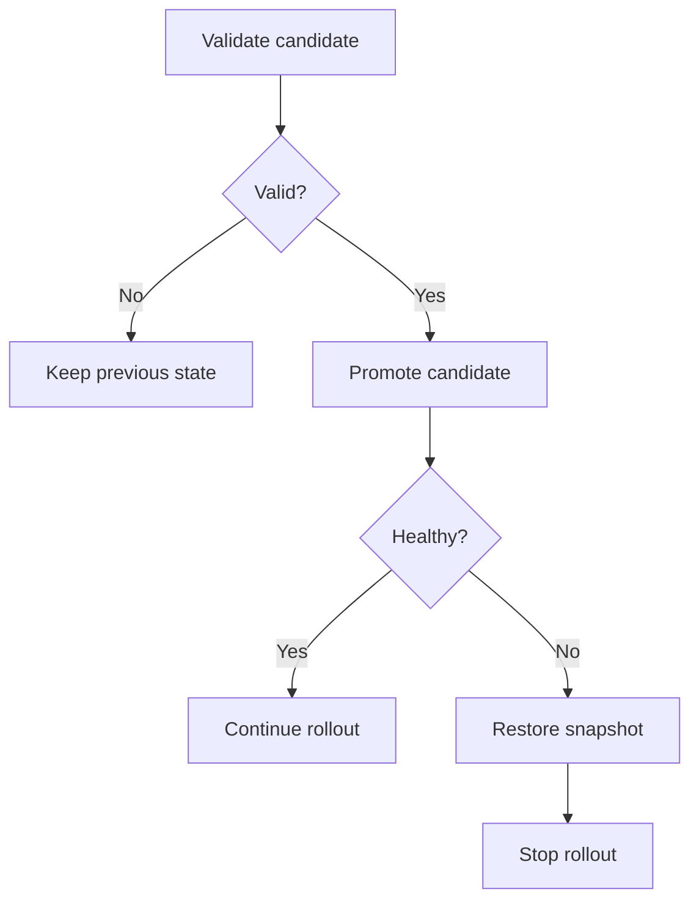

# Failure, recovery, and honest outcomes

Ansible changes systems task by task. It does not wrap a play in a database transaction. When a late task fails, earlier mutations remain unless you explicitly reverse them.

## Describe the post-failure state first

Before writing a rescue block, answer: what may already have changed, what previous state is available, what can be restored safely, and should the overall run still fail after recovery?

Lab 10 validates a candidate before replacing the live file. Its rescue message is appropriate because no promotion occurred. Project 02 instead writes a release, checks it, restores a snapshot after failure, and deliberately fails the run so later batches stop.



## Blocks are error handling

`block` groups tasks. `rescue` runs after a task inside the block returns a failure. `always` handles the common follow-up path after normal block/rescue execution. Invalid task definitions and unreachable hosts do not behave like ordinary task failures and do not trigger those sections.

A successful rescue can make the host continue as recovered. If deployment failed but recovery succeeded, use an explicit `ansible.builtin.fail` after recovery when the operational outcome must remain a failed deployment. Otherwise a pipeline may report success and continue rollout even though the requested release did not deploy.

## Classify commands explicitly

```yaml
# Task fragment for a read-only probe with an existing tool.
- name: Inspect application status
  ansible.builtin.command:
    argv: [/usr/local/bin/course-status]
  register: course_status
  changed_when: false
  failed_when: course_status.rc not in [0, 3]
```

The accepted codes must come from the actual tool's contract. Do not copy `[0, 3]` to an unrelated command. A list of separate `failed_when` expressions is combined with logical AND; use an explicit expression with `or` when either condition should fail the task.

## Retries are bounded waiting

Use `until`, `retries`, and `delay` when a valid operation needs time to become observable. Retrying a broken input or a non-idempotent mutation can make the problem worse. Probe health separately from changing state where possible.

`ignore_errors` continues after some task failures; it does not repair their effects. Reserve it for a documented optional operation whose failure does not invalidate later work. Prefer an explicit accepted return-code policy to ignoring all errors.

## Recovery has limits

A rollback might fail. A remote host might disappear after promotion. A database schema change may not be reversible by switching an application release. A checksum may match corrupted data if the manifest is also replaced. State these limits in the project rather than presenting a local demonstration as a production guarantee.

<details><summary>Self-check: why does project 02 fail after it successfully restores the old release?</summary>

Recovery succeeded, but deployment did not. The final failure preserves that distinction and activates the play's stop policy so later batches do not proceed.

</details>

Practice: [lab 10](../labs/lab10/README.md), [project 02](../projects/02-rolling-release/README.md). Reference: [Blocks](https://docs.ansible.com/projects/ansible/latest/playbook_guide/playbooks_blocks.html), [error handling](https://docs.ansible.com/projects/ansible/latest/playbook_guide/playbooks_error_handling.html).
